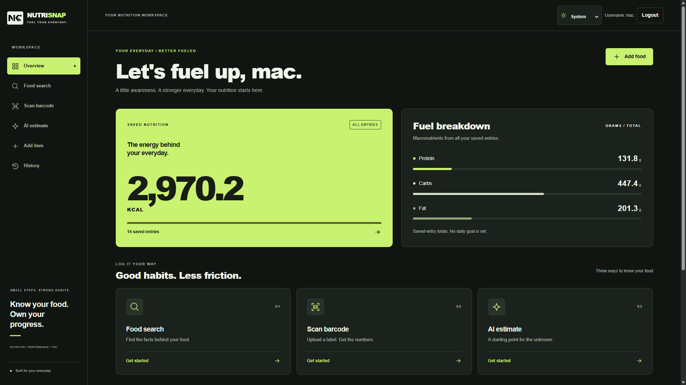

# Nutri-Kcal Frontend

React frontend for Nutri-Kcal (NutriSnap), a nutrition management web application where users can search food nutrition by text, scan barcode images, get AI-assisted estimates, save entries, and review history.

## Live Links

- Live app: https://comp229-nutrisnap-client1.onrender.com/
- Team report: https://client-jaturaput-portfolio.onrender.com/portfolio/NUTRI-SNAP_Nutrition_Management_Application_Report.pdf

## Frontend Repository

- GitHub: https://github.com/Jaturaput-Jongsubcharoen/COMP229-NutriSnap-Client1

## Skills Demonstrated

- Building multi-page React SPA with React Router
- API integration with Nutritionix (search and barcode flows)
- JWT-based authentication flow integration with backend
- Browser storage session handling with localStorage
- AI-assisted UX integration using Gemini SDK
- File input and client-side barcode decoding workflow
- User-centered data entry and history interfaces
- Cross-origin client/server deployment workflow

## Technologies Used

- React 18
- Vite
- React Router DOM
- Axios and Fetch API
- Quagga (barcode decoding)
- Google Generative AI SDK
- CSS
- Render deployment

## Core Features

- User registration and login
- JWT-authenticated profile display
- Nutrition search by food text
- Barcode image upload and decode
- AI-assisted nutrient estimate flow
- Add custom item manually
- Save nutrient entries to backend and MongoDB
- View and remove saved history items

## Team Contributions And Challenges

This summary is based on role annotations in the code and project metadata.

- Jaturaput: full-stack integration, MongoDB connectivity, JWT flow integration, user-bound data operations, deployment, and main page orchestration.
- Sukhmanpreet: authentication UI and backend-compatible register/login flow.
- Joseph: barcode and text search flows, Nutritionix integration, and nutrient save handoff.
- Gowsith: AI nutrition estimate flow and prompt-based result generation experience.
- Aryan: add-item custom nutrition entry UI and persistence flow.

Main team challenges and how the project addresses them:

- Challenge: keeping all nutrition data user-specific.
	Solution: JWT token attached in authenticated requests and backend reads user ID from token.
- Challenge: combining AI-estimated data with API-based factual nutrient data.
	Solution: separate flows (AI estimate, Nutritionix search, barcode lookup) with optional save after user review.
- Challenge: inconsistent third-party API responses and missing barcode matches.
	Solution: conditional rendering, error messages, and fallback prompts to retry.
- Challenge: syncing frontend forms with backend required fields.
	Solution: explicit payload mapping before save and form-level required inputs.
- Challenge: preserving state across navigation and login state changes.
	Solution: localStorage token storage and username fetch on page mount.

## Application Flow

1. User opens app, sees main dashboard tiles.
2. User signs up and logs in.
3. User chooses one of three nutrition intake paths:
	 - text search
	 - barcode scan from image
	 - AI estimate
4. User reviews nutrient values.
5. User saves nutrient entry.
6. User opens history to review or remove saved entries.

## Detailed Functionality By Page

### App Routing

App routes include:

- /: Main dashboard
- /predict-image: AI estimate page
- /history: Saved history page
- /login: Login page
- /register: Register page
- /add-item: Custom item page
- /barcode: Barcode scanner page
- /text-search: Text nutrient search page

### Main Page

- Loads current username by calling backend getUser endpoint with JWT.
- Shows login or logout action based on auth state.
- Provides navigation tiles for all feature pages.

### Login Page

- Accepts username and password.
- Sends credentials to backend login endpoint.
- Saves token and userID in localStorage on success.
- Navigates back into app after authentication.

### Register Page

- Accepts username, email, and password.
- Sends register request to backend.
- Redirects to login after successful account creation.

### Text Search Page

- Takes user food text query.
- Calls Nutritionix natural language endpoint.
- Displays calories, protein, fat, carbs in table.
- Saves selected nutrient result to backend MongoDB through nutrients endpoint.

### Barcode Page

- Accepts barcode image upload.
- Uses Quagga to decode UPC or EAN barcode from image.
- Calls Nutritionix item endpoint using barcode.
- Displays nutrient table and allows save to backend.

### Predict Image (AI Guess) Page

- Accepts food description input.
- Sends prompt to Gemini model and receives nutrition-oriented response.
- Lets user manually adjust nutrient values.
- Saves manually confirmed values to backend.

### Add Item Page

- Lets user manually input food nutrient fields and meal type.
- Optionally attaches barcode image file metadata for local form context.
- Sends nutrient payload to backend save endpoint.
- Maintains local session history list in page state.

### History Page

- Fetches all user-bound entries from backend apiMongo endpoint.
- Renders each entry details (name, macros, meal type).
- Allows item deletion by ID through backend delete endpoint.

## Environment Variables

Create a .env file in this frontend project root:

VITE_BE_URL=http://localhost:8081
VITE_NUTRITIONIX_APP_ID=your_nutritionix_app_id
VITE_NUTRITIONIX_API_KEY=your_nutritionix_api_key

Notes:

- VITE_BE_URL must point to the backend base URL.
- Nutritionix keys are required for text and barcode nutrient retrieval.

## Installation And Run Guide

### Prerequisites

- Node.js 18+ recommended
- npm 9+ recommended
- Running backend from COM229-NutriSnap-Server1

### Install

1. Open terminal in this repository.
2. Run npm install.

### Start Development Server

1. Ensure backend server is running.
2. Run npm run dev.
3. Open the local URL shown by Vite (usually http://localhost:5173).

### Build For Production

1. Run npm run build.
2. Optional local preview: npm run preview.

## How To Use

1. Register a new account.
2. Login with that account.
3. Choose text search, barcode scan, AI estimate, or add item.
4. Save entries you want to keep.
5. Open history to review and remove entries.

## Notes For Reviewers

- If docs/live-demo-screenshot.png is missing in your local clone, add your screenshot file at that path so the README header image renders.
- If external API calls fail, verify Nutritionix keys and backend URL first.

## Backend Pair

- Backend repo: https://github.com/Jaturaput-Jongsubcharoen/COM229-NutriSnap-Server1

## Frontend Design And Technical Documentation

- [Design system](DESIGN.md): themes, typography, components, accessibility, and responsive behavior.
- [Frontend architecture](ARCHITECTURE.md): folder structure, routing, component responsibilities, and data flow.
- [API integration](API_INTEGRATION.md): request contracts, authentication, configuration, and verification.
